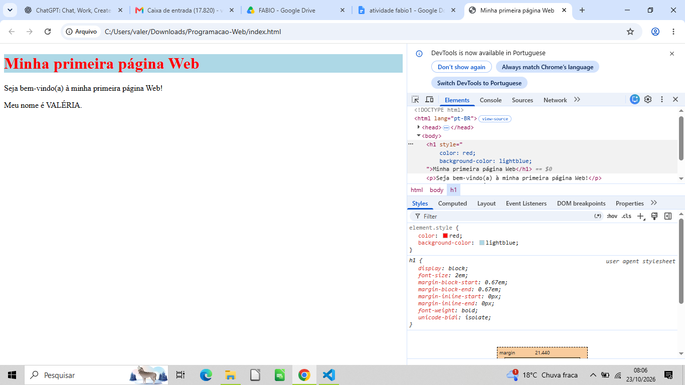

# Programacao-Web
Minha primeira atividade de Programação Web

# Minha primeira página Web

Nome: VALERIA

## Sobre a atividade

Esta é minha primeira página desenvolvida na disciplina
Programação Web.

## Tecnologias utilizadas

- HTML
- Git
- GitHub
## Evidência das DevTools

Abaixo está a captura de tela da página aberta no navegador
com a propriedade visual alterada nas DevTools.

Salve clicando em Commit changes.

A imagem deverá aparecer diretamente no README do GitHub.
